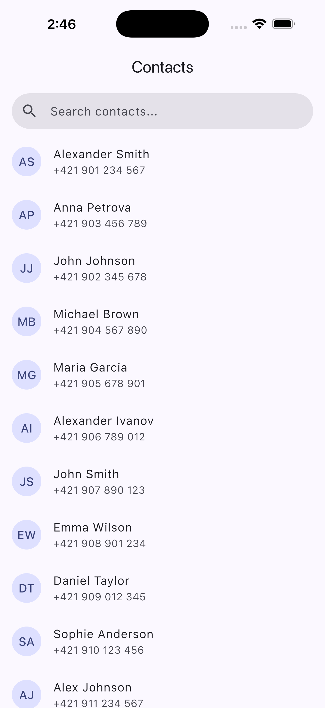
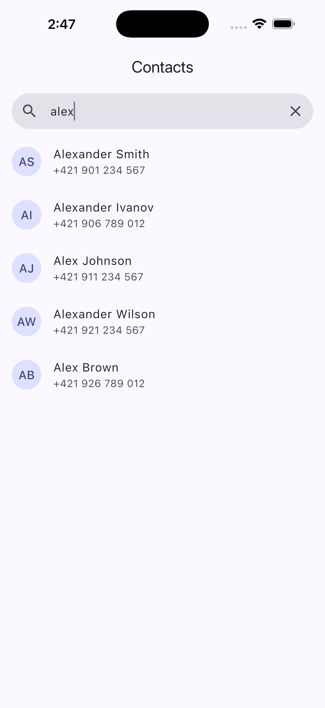
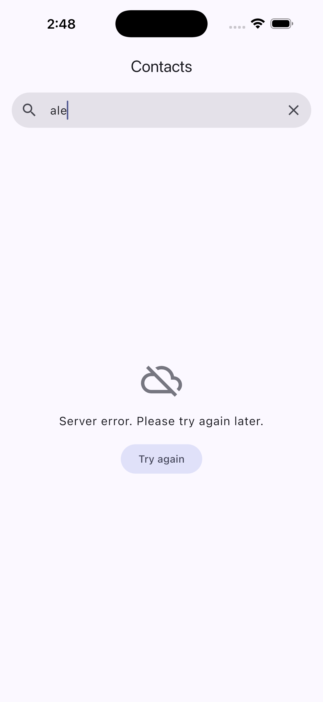
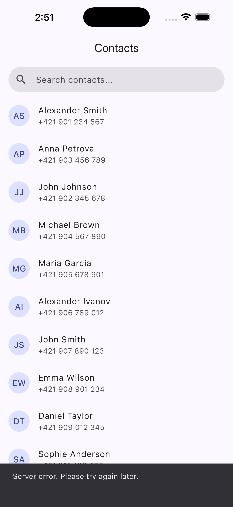
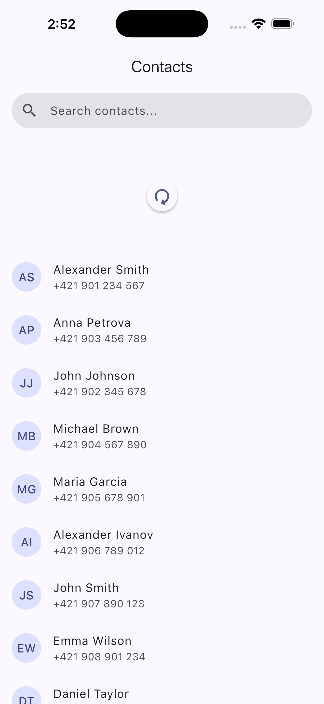

# Contacts Search

A searchable, paginated contacts list built against a mock backend.

## Screenshots

<table>
  <tr>
    <td align="center"><br>Contacts list</td>
    <td align="center"><br>Search for alex</td>
    <td align="center"><br>Request failed</td>
    <td align="center"><br>Refresh failed</td>
    <td align="center"><br>Pull to refresh</td>
  </tr>
</table>

## Running

```bash
flutter pub get
dart run build_runner build --delete-conflicting-outputs
flutter run
```

Generated files (`*.freezed.dart`, `*.g.dart`, `injection.config.dart`) are
gitignored. Run `build_runner` after clone, and again after changing a model,
an entity, the bloc's events/state, or a DI annotation.

The mock API fails 20% of requests (1 in 5) so the error states can be seen.
The rate can be changed at build time:

```bash
flutter run --dart-define=MOCK_FAILURE_PERCENT=50    # fail half of the requests
flutter run --dart-define=MOCK_FAILURE_PERCENT=0     # never fail
```

## Versions

- Flutter 3.47.7 (stable)
- Dart 3.13.5

## State management

**BLoC** (`flutter_bloc`).

Most of the interesting parts of this task are about *events over time*:
debouncing keystrokes, dropping out-of-date responses, ignoring duplicate
"load more" triggers. Keeping all of that in one bloc, away from the widgets,
makes it easy to follow. Search waits 400 ms after each keystroke and only
continues if nothing newer was typed, so `a → al → ale → alex` sends a single
request.

Events and state are `freezed` sealed unions. The state is one of
`loading`, `failure` or `loaded`, so impossible combinations (e.g. "loading"
with an error message) can't be represented. Only `loaded` carries the list
and its paging details (next page loading/failed, refreshing). The UI picks
what to render with a plain Dart `switch` over the state type.

Widget-local state (the search and scroll controllers, the scroll listener)
uses `flutter_hooks`, so there is no `initState`/`dispose` boilerplate and
nothing can be forgotten when the screen is disposed.

Dependencies are wired with `get_it` + `injectable`: classes register
themselves through annotations (`@LazySingleton(as: ...)`, `@injectable`) and
the registration code is generated.

## Architecture

Feature-first, with each feature split into `data`, `domain` and `presentation`:

```
lib/
├── core/                    shared across features
│   ├── di/                  get_it + injectable setup
│   ├── error/               AppException (Network/Server)
│   ├── theme/
│   └── utils/
└── features/
    └── contacts/
        ├── domain/          Contact, PaginatedContacts (entities)
        ├── data/            JSON models, remote data source + mock, ContactsRepository
        └── presentation/    ContactsBloc, ContactsScreen, widgets
```

Flow: `UI → ContactsBloc → ContactsRepository → ContactsRemoteDataSource`.

- **Data source** — `ContactsRemoteDataSource` describes the API.
  `MockContactsRemoteDataSource` filters/pages the provided dataset, adds
  500–1000 ms latency, fails a configurable share of requests with a `ServerException`,
  and builds a JSON payload that goes through the same `fromJson` parsing a real
  response would.
- **Models** — `freezed` + `json_serializable` DTOs (`ContactModel`,
  `ContactsResponseModel`, `PaginationMetaModel`) that convert to the domain
  entities (`Contact`, `PaginatedContacts`, also `freezed`).
- **Repository** — a concrete class that maps API models to domain entities,
  so the bloc and UI never deal with JSON models. There is deliberately only one
  abstraction (the data source interface): that is where the backend gets
  swapped, and a second interface on top of the repository would only forward
  calls.
- **Bloc** — owns paging, query and error handling. Every first-page load
  (start, search, refresh, retry) bumps a generation counter; responses from an
  older generation are discarded, which covers both "slow `al` overwrites
  `alex`" and "page 2 of the old query appended to the new list".

To switch to a real backend, add e.g. a `DioContactsRemoteDataSource` that
maps HTTP errors to `AppException`, annotate it with
`@LazySingleton(as: ContactsRemoteDataSource)` and remove the annotation from
the mock (or give both an `@Environment` and pick one at startup). Nothing else
needs to change.

There is intentionally no use-case layer: with a single repository call it
would only forward arguments.

## Behaviour notes

- Search is case-insensitive, trims whitespace, matches names and (for numeric
  queries) phone numbers. Debounce is 400 ms.
- A new query clears the list and shows the loader, so old results are never
  shown for a new query.
- Next page loads when the user is ~300 px from the bottom. If the first page
  doesn't fill the screen, the next one is requested automatically.
- A failed next page keeps loaded contacts and shows a retry button at the
  bottom.
- Pull-to-refresh reloads page 1 for the current query and replaces the list.
  If it fails while contacts are on screen, the list is kept and a snackbar is
  shown.